<picture>
  <source media="(prefers-color-scheme: dark)" srcset="assets/header-dark.svg">
  
</picture>

  
  
  

  <b>I take messy business questions, find the data that answers them, and ship the product that makes the answer usable.</b> 
  Strategy · Product · Go-to-market · Healthcare · AI

---

### About me

- 🎓 **Master in Management (STEM)** at **Chicago Booth**, Class of 2027 · **BSc Economics & Business**, LUISS Guido Carli, Rome
- 💼 Background in **pharma marketing, product management and go-to-market**
- 🤖 Consulting work on **generative AI use cases** and **LLM chatbot evaluation**
- 🛠️ I build what I analyze: public dashboards, practice platforms and mobile apps, from data pipeline to release
- 🌍 Italian · English · Spanish

 

<table align="center">
  <tr>
    <td align="center" valign="top" width="25%"><h2>209</h2>new drugs tracked from approval to patient access</td>
    <td align="center" valign="top" width="25%"><h2>7</h2>public agencies stitched into one sourced dataset</td>
    <td align="center" valign="top" width="25%"><h2>80</h2>original consulting cases, free for everyone</td>
    <td align="center" valign="top" width="25%"><h2>2,091</h2>case numbers verified by automated tests</td>
  </tr>
</table>

### Featured work

<table>
  <tr>
    <td width="50%" valign="top">
      
      <h3><a href="https://lucamurri.github.io/pharma-access-atlas/">Pharma Access Atlas</a></h3>
      
How fast, and on what terms, new drugs reach patients in the US and Europe. Every medicine approved by both the FDA and the EU in 2019–2025, tracked to benefit assessment and reimbursement in Germany, France, England and Italy.

      
Available in English, Italian, German and French. <b>Every value links to its public source</b>, and anything that couldn't be verified is flagged, not estimated.

      

        
        
        
        
      

      
<a href="https://lucamurri.github.io/pharma-access-atlas/"><b>Live site</b></a> · <a href="https://lucamurri.github.io/pharma-access-atlas/insights.html">Findings</a> · <a href="https://github.com/lucamurri/pharma-access-atlas">Code</a>

    </td>
    <td width="50%" valign="top">
      
      <h3><a href="https://lucamurri.github.io/case-interview-engine/">Case Interview Engine</a></h3>
      
A free library of 80 original consulting cases with a step-by-step practice mode, a partner mode for practicing with a friend, mental-math drills and fit-interview practice.

      
No sign-up, no paywall, no tracking. <b>Every number in every case is recalculated by a test</b> before it goes live. Accessible by design: WCAG AA, zero axe-core issues.

      

        
        
        
        
      

      
<a href="https://lucamurri.github.io/case-interview-engine/"><b>Try it live</b></a> · <a href="https://github.com/lucamurri/case-interview-engine">Code</a>

    </td>
  </tr>
</table>

  
<b>📈 Three findings from the Pharma Access Atlas</b> (click to expand)

   

  1. **EU approval is only the start.** It came a median of **213 days** after the FDA's. Counting from EU approval, half of new drugs had a French HAS opinion within **212 days**, a German G-BA decision within **232**, English NICE guidance within **399** and Italian reimbursement within **522**.
  2. **Most new drugs show no added benefit in Germany.** Of the 116 drugs assessed against an existing therapy, **72% showed no added benefit** for any patient group.
  3. **"No added benefit" in Germany often still means "yes" in England.** Of the 63 drugs Germany rated as having no added benefit that NICE also appraised, **81% received a positive NICE decision**, because NICE judges value for money at the price offered.

  Data as of 11 November 2026, with drugs still waiting counted using Kaplan–Meier curves. Full analysis on the <a href="https://lucamurri.github.io/pharma-access-atlas/insights.html">Insights page</a>. The project grew out of my <a href="https://tesi.luiss.it/45530/">bachelor thesis</a> on drug pricing and reimbursement in Europe and the United States.

### In development

**🏠 HomeDef** · *private repository* 
A mobile app that gives homeowners, landlords, tenants and their families one shared place for everything about a home: documents, expenses, rent and bills, maintenance requests, a shared calendar and owner–tenant messaging. Each person sees only what their role allows, and that rule is enforced by the database itself and checked by a suite of nearly 200 access-control tests.

    

### How I work

<table>
  <tr>
    <td width="25%" valign="top"><b>🔗 Sourced</b> Every number traces back to a public source. If it can't be verified, it's flagged, not guessed.</td>
    <td width="25%" valign="top"><b>🧪 Tested</b> Math, data and access rules are checked by automated tests, not by eye.</td>
    <td width="25%" valign="top"><b>♿ Accessible</b> Mobile-first, dark mode, keyboard and screen-reader friendly from day one.</td>
    <td width="25%" valign="top"><b>🚀 Shipped</b> Live early, free to use, and improved from real feedback.</td>
  </tr>
</table>

### Toolbox

  
  
  
  
  
  
  
  
  

**Interested in:** startups · healthtech · AI products · real-estate tech · finance

 

<picture>
  <source media="(prefers-color-scheme: dark)" srcset="https://raw.githubusercontent.com/lucamurri/lucamurri/output/github-snake-dark.svg">
  
</picture>

<i>Always happy to talk strategy, product or healthcare. <a href="https://www.linkedin.com/in/lucamurri">Say hi on LinkedIn</a>.</i>

